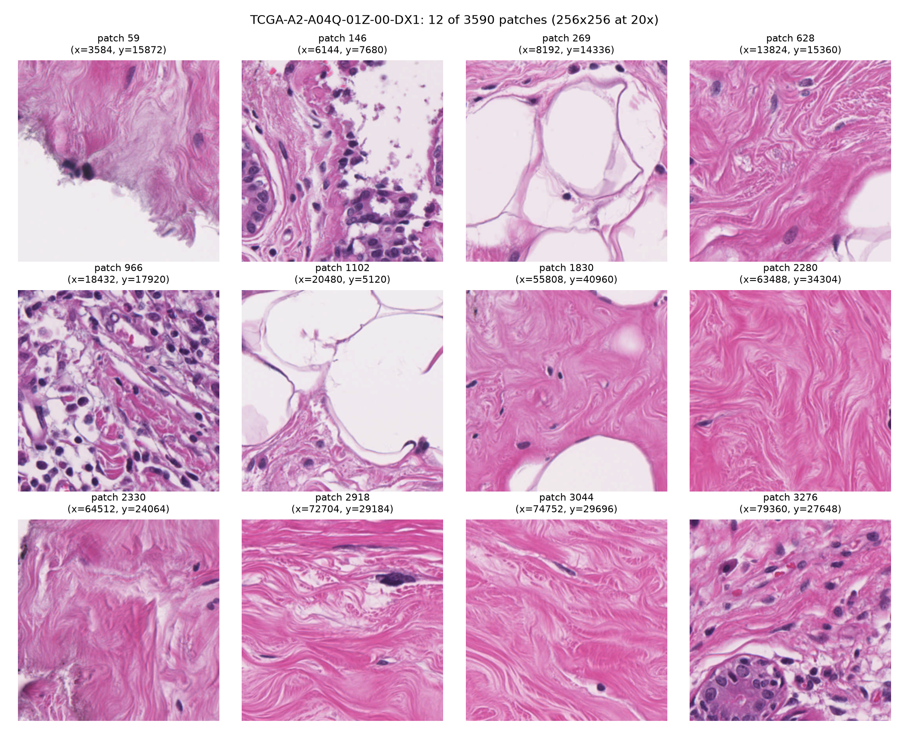

# Does Multimodal Fusion Beat Clinical Variables?
### A leakage-controlled benchmark for breast cancer progression risk, with external validation on METABRIC

PBL-3 (DSE3170) project, Department of Data Science and Engineering, Manipal University Jaipur.

For breast cancer patients, does combining several kinds of patient data predict **who will relapse or progress sooner** better than the routine clinical facts doctors already record? We build one survival model per data type, fuse their risk scores in three ways, and test every model against a clinical-only baseline on the **same patients and the same 25 train/test splits**, with a corrected significance test.



---

## Key results

| Dataset | Clinical C-index | Stacking C-index | Gain | 95% CI | p | Splits better |
|---|---|---|---|---|---|---|
| TCGA-BRCA (898 patients, 122 events) | 0.680 | 0.696 | +0.017 | -0.016 to +0.049 | 0.30 | 19/25 |
| METABRIC A: same 7 clinical variables (1,900 patients, 769 events) | 0.639 | 0.662 | +0.023 | +0.011 to +0.035 | 0.001 | 25/25 |
| METABRIC B: + grade, ER, HER2 | 0.648 | 0.660 | +0.012 | +0.004 to +0.020 | 0.004 | 24/25 |
| METABRIC C: + methylation (1,403 patients, 574 events) | 0.637 | 0.662 | +0.024 | +0.014 to +0.035 | <0.001 | 24/25 |

**Findings**

1. No single molecular data type beats routine clinical variables on its own, in either dataset.
2. Learned fusion (stacking) adds a small gain of about +0.02. TCGA had too few events to prove it; METABRIC, with 6x more events, confirms it.
3. About half of that gain disappears when grade, ER and HER2 are added to the clinical baseline. The rest stays significant.
4. How you fuse matters: equal-weight averaging was never significant, and on TCGA it was worse than clinical alone.
5. Methylation adds nothing beyond RNA.

### TCGA-BRCA: all models (C-index, mean ± SD over 25 splits)

| Model | C-index | Gain vs clinical | p |
|---|---|---|---|
| **Stacking** | **0.696 ± 0.040** | **+0.017** | **0.30** |
| Clinical (7 variables) | 0.680 ± 0.039 | — | — |
| Concatenation | 0.674 ± 0.044 | -0.006 | 0.81 |
| Equal-weight average | 0.661 ± 0.047 | -0.019 | 0.52 |
| RNA | 0.611 ± 0.060 | -0.069 | 0.075 |
| Pathology reports | 0.606 ± 0.060 | -0.074 | 0.084 |
| Slides (ABMIL) | 0.584 ± 0.056 | -0.095 | 0.018 |
| Mutations | 0.464 ± 0.061 | -0.216 | <0.001 |

### METABRIC: all models

| Model | A: 7 variables | B: + grade, ER, HER2 | C: + methylation |
|---|---|---|---|
| **Stacking** | **0.662** (+0.023, p 0.001) | **0.660** (+0.012, p 0.004) | **0.662** (+0.024, p <0.001) |
| Concatenation | 0.663 (+0.023, p 0.003) | 0.662 (+0.014, p 0.016) | 0.665 (+0.027, p 0.011) |
| Equal-weight average | 0.656 (+0.017, p 0.20) | 0.653 (+0.005, p 0.64) | 0.654 (+0.017, p 0.12) |
| Clinical | 0.639 | 0.648 | 0.637 |
| RNA | 0.613 | 0.613 | 0.614 |
| Methylation | — | — | 0.603 |
| Mutations | 0.570 | 0.570 | 0.569 |

---

## Method

| Data type | Features | Model |
|---|---|---|
| Clinical | TCGA: age, AJCC stage, T, N, lobular, other histology, post-menopausal. METABRIC: the same roles (tumour size for T, positive nodes for N) + missing-stage flag; optional grade, ER, HER2 | Cox |
| RNA expression | Top 2,000 most variable genes -> PCA to 10 | Cox |
| Mutations | Top 10 mutated genes (yes/no) + log mutation count | Cox |
| Pathology reports (TCGA) | TF-IDF (1-2 word terms) -> SVD to 10 | Cox |
| Slides (TCGA) | UNI2-h patch features, 1,024 patches per patient | Attention MIL (ABMIL) with Cox loss |
| Methylation (METABRIC) | Top 2,000 most variable promoters -> PCA to 10 | Cox |

**Fusion:** concatenation (early), equal-weight average of risk scores (late), and stacking (a Cox meta-learner trained on out-of-fold risk scores).

**Evaluation:** 5-fold cross-validation repeated 5 times (25 shared splits); all feature selection, PCA, TF-IDF, scaling and imputation fitted on training patients only; Harrell's C-index; gains tested with the Nadeau-Bengio corrected t-test; Kaplan-Meier median-split risk groups with log-rank test.

Treatment variables (chemotherapy, hormone therapy, radiotherapy) and the Nottingham Prognostic Index are deliberately excluded to avoid leaking the outcome.

---

## Data (not included in this repo)

| File / folder | Source |
|---|---|
| `cdr.xlsx` | TCGA-CDR, Liu et al. 2018 (supplementary table S1) |
| `brca_tcga_pan_can_atlas_2018/` | cBioPortal: Breast Invasive Carcinoma (TCGA, PanCancer Atlas) |
| `TCGA_Reports.csv` | TCGA-Reports, Kefeli and Tatonetti 2024 |
| `features/*.h5` | UNI2-h slide features from MahmoodLab on Hugging Face (gated access) |
| `metabric/brca_metabric/` | cBioPortal: Breast Cancer (METABRIC, Nature 2012 & Nat Commun 2016) |

UNI2-h features are licensed CC-BY-NC-ND and must not be redistributed. Download every dataset yourself and place it in the folders above.

---

## Setup

```powershell
pip install pandas numpy scipy scikit-learn statsmodels h5py openpyxl matplotlib huggingface_hub requests
pip install torch --index-url https://download.pytorch.org/whl/cu128
# optional, only for get_patches.py
pip install openslide-python openslide-bin
```

Python 3.12+. A GPU is needed only for the slide attention model (tested on an RTX 3050, 6 GB).

---

## How to run

**TCGA-BRCA**

```powershell
cd tcga
python cohort.py              # build the 898-patient cohort
python clinical_baseline.py   # age + stage baseline
python clinical_plus.py       # 7-variable clinical model
python rna_model.py
python mutation_model.py
python text_model.py
python check_slides.py
python pool_slides.py
python slide_model.py
python build_bags.py
python attn_model.py          # ABMIL on slide patches (GPU, about 20 min)
python fusion2.py             # all models + 3 fusion methods on 25 splits
python get_numbers.py         # final table, CIs, p-values, weights, log-rank
```

**METABRIC (external validation)**

```powershell
cd tcga\metabric
python peek_metabric.py                     # optional: inspect columns and counts
python metabric_fusion.py                   # run A: 7 clinical variables + RNA + mutations
python metabric_fusion.py --extended        # run B: + grade, ER, HER2
python metabric_fusion.py --methylation     # run C: + methylation
```

Each METABRIC run takes about 3-8 minutes and saves `scores_*.csv`, `weights_*.csv` and `risks_*.csv`.

**Extras**

```powershell
python make_samples.py   # data_samples.xlsx: a few rows of every raw data type
python get_patches.py    # real H&E patches from one slide (patch_grid.png, slide_thumbnail.png)
```

---

## Limitations

- TCGA has only 122 events, which limits the power to detect small gains.
- TCGA uses progression-free interval and METABRIC uses relapse-free survival, with different RNA and mutation platforms, so we compare the pattern rather than exact numbers.
- METABRIC repeats the pipeline within METABRIC; models are not transferred from TCGA.
- Reports and slides exist only in TCGA.
- Only discrimination (C-index) is measured, not calibration.

---

## Team

Ram Kumar Yadav, Shivangi Kotnala, Sumit Gareri, Aadhya Govil, Ritvik Chakka, Anushka Dhanuka

---

## References

1. Liu et al., An integrated TCGA pan-cancer clinical data resource, *Cell*, 2018.
2. Cerami et al., The cBio cancer genomics portal, *Cancer Discovery*, 2012.
3. Kefeli and Tatonetti, TCGA-Reports, *Patterns*, 2024.
4. Chen et al., Towards a general-purpose foundation model for computational pathology (UNI), *Nature Medicine*, 2024.
5. Ilse, Tomczak and Welling, Attention-based deep multiple instance learning, ICML 2018.
6. Cox, Regression models and life-tables, *JRSS B*, 1972.
7. Harrell et al., Evaluating the yield of medical tests, *JAMA*, 1982.
8. Nadeau and Bengio, Inference for the generalization error, *Machine Learning*, 2003.
9. Curtis et al., The genomic and transcriptomic architecture of 2,000 breast tumours, *Nature*, 2012.
10. Pereira et al., The somatic mutation profiles of 2,433 breast cancers, *Nature Communications*, 2016.